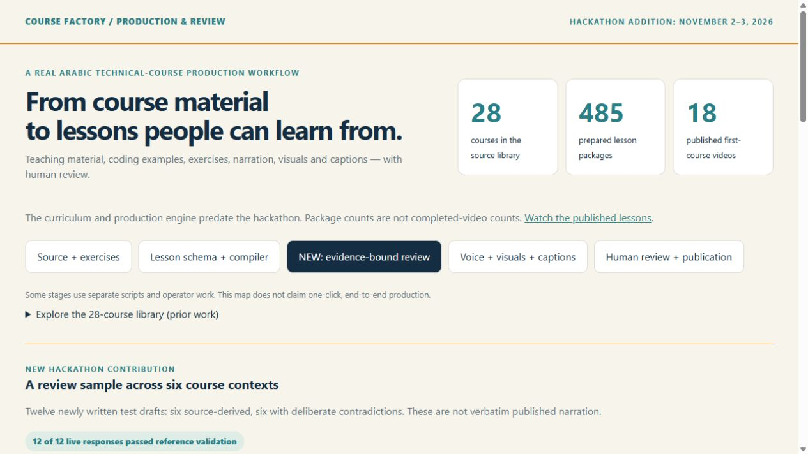

# Course Factory

**A human-supervised workflow for producing Arabic technical lessons, with a new evidence-bound review step.**

The existing source library spans **28 courses and 485 prepared lesson packages** across computing, software, systems, data and AI. The first course has **18 publicly available videos**, totaling nearly six hours. Prepared packages are not completed-video counts. [Published lessons](docs/published-lessons.md).

Behind a finished lesson are source material, coding examples, exercises, narration, visuals, captions and review. The repository includes the earlier lesson schema/compiler, workspace and execution components, recording/voice components and Teaching IDE. Some stages still use separate scripts and operator work. This is a real production workflow, not a claim of one-click automation.

**[Watch the revised Course Factory demo (2 minutes 35 seconds)](https://youtu.be/yYDbz-zuqvY)** — project context, published lesson excerpt and the new review contribution.



## New hackathon contribution

Reviewing explanations before narration and rendering is a practical production problem. The new reviewer compares a teaching draft with supplied source material using Muse Spark 1.3 through Meta Model API. The application validates the source IDs and exact quotations, records hashes, and always requires human review before publication.

The new work was built November 2–3, 2026: direct Meta adapter, evidence contract, JSON review runner, bounded sample runner, production-context dashboard, tests and live receipts. The curriculum and earlier production engine predate the event. Muse was previously used through OpenCode Go for course-material production/review alongside other models; that is distinct from this new direct API integration. [Contribution boundary](docs/hackathon-contribution.md).

## What the broader demonstration shows

Twelve real Muse calls cover newly written test drafts from six existing lesson contexts: HTTP, Python functions, SQL transactions, idempotency, prompt injection and MCP. All six source-derived drafts returned no findings. All six deliberately contradictory drafts returned findings. Every returned quotation passed local reference validation; no draft was approved for publication.

This is a small constructed sample, **not an independent accuracy benchmark or an assessment of the whole library**. Source material can itself contain errors; matching quotations establish reference integrity, not truth. Historical execution evidence keeps its original dates and scope. [Inputs, results and limitations](docs/library-review-sample.md).

## Unchanged-text follow-up

We also reviewed six existing production/library artifacts without injecting errors. The primary batch produced five valid zero-finding responses and one invalid-response failure. A preserved, separate diagnostic run returned four findings; checking their scope yielded three proposed changes that the owner judged correct and useful. One evidence gap remains unresolved. This is not an independent benchmark, and review time savings were not measured. [Method, failures, owner feedback and limits](docs/natural-review.md).

## Try the source and review workflow

Requirements: Node.js 24+, Python 3, npm.

```sh
npm ci --ignore-scripts
npm test
npm run demo
npm run inventory
npm run review:sample
npm run review:dashboard
```

Open **http://127.0.0.1:8317**. Explore the course library and six-context review sample, inspect the cited evidence, switch to the source-derived draft and test a fabricated quotation. The dashboard replays saved responses from actual Meta calls. Default commands need no API key and make no model request.

The core demo validates/compiles a synthetic lesson fixture, runs a trusted Python example and labels its offline review fixture explicitly. It does not run the entire curriculum or certify every native production component.

### Review your own supplied draft

```sh
npm run review:json -- --input your-draft.json --output new-receipt.json
```

This validates an input shaped like the files in `examples/review-sample/`. Set `MODEL_API_KEY` in the environment and add `--live` to make one real Meta request. The JSON runner **never executes supplied code or commands**, and refuses to overwrite an existing receipt. An API call may consume your account credits; no automatic retry is sent. [Meta usage](docs/meta-usage.md).

`npm run review:sample` revalidates the twelve saved receipts without inference. `review:sample:live` calls Meta only for missing sample receipts. Failed or rejected results are preserved, not silently repaired.

## Engineering and validation

The current snapshot passes **208 Node tests**: 107 schema tests, 82 compiler tests, 10 evidence-contract tests and 5 JSON CLI boundary tests and 4 provider-response tests. The trusted Python example has two tests and seven boundary assertions. The six dashboard pairs were exercised through the browser. The Teaching IDE bundle built with documented pre-existing warnings; Docker, Electron, recording and provider-dependent paths have their own setup requirements and are not all certified by the quickstart.

- `packages/shared-types/`, `engine/`, `apps/teaching-ide/`: earlier production components.
- `tools/lesson-review/`, `tools/review*.mjs`, `apps/review-dashboard/`: new review contribution.
- `examples/review-sample/`, `evidence/library-review/`: frozen inputs and actual live receipts.
- `data/`: complete package inventory metadata and public-video links.
- `docs/`: architecture, contribution boundary, evidence scope and reproduction.

## Publication boundary

This public repository is an inspectable component snapshot and selected demonstration material. It excludes credentials, private voice assets, proprietary fonts, the full private curriculum and large rendered files. Public visibility does not grant redistribution rights to those excluded assets. No broad open-source license is asserted. [Architecture](docs/architecture.md), [verification](evidence/verification.json).
