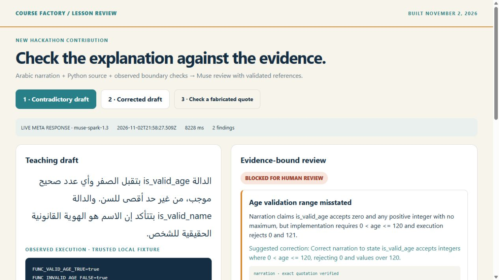
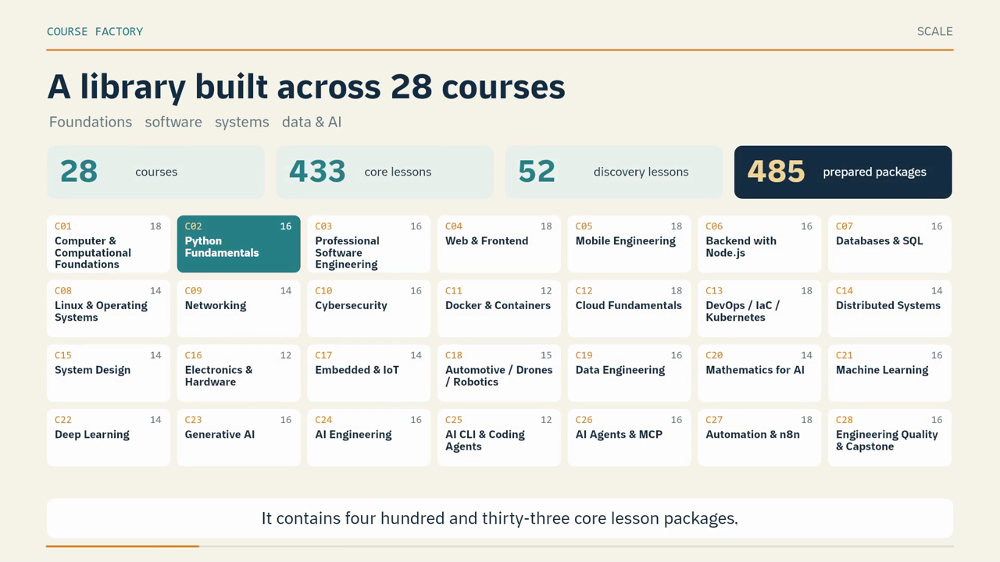

# Course Factory · Evidence-bound Arabic lesson review

**A new review step for a real Arabic technical-course production workflow.** Muse compares an Arabic teaching draft with its Python source and observed execution. The application verifies each cited quotation against its source, binds it to a SHA-256 hash, and keeps publication under human review.

The **new hackathon contribution** is the reviewer, its Meta Model API adapter, evidence validation, comparison dashboard and documented live runs, built November 2–3, 2026. The curriculum and earlier production engine predate the event. See [the contribution boundary](docs/hackathon-contribution.md).



## Try it

Requirements: Node.js 24+, Python 3, npm. No API key or paid service is needed for the default demo.

```sh
npm ci --ignore-scripts
npm test
npm run demo
npm run inventory
npm run review:dashboard
```

Open **http://127.0.0.1:8317**. Compare the contradictory and corrected drafts, then check a fabricated quotation. The dashboard displays saved responses from actual Meta calls; changing tabs does not call a model. The default CLI demo clearly labels its offline fixture.

### Run a real Meta review

Set `MODEL_API_KEY` in your environment, then:

```sh
npm run review:live
npm run review:live -- --corrected
```

These commands make one request each to `https://api.meta.ai/v1/responses` using `muse-spark-1.3`. They may consume your Meta account credits. No automatic retries are sent. The example executes only the checked-in trusted Python fixture, not commands supplied by the model. [Usage and limitations](docs/meta-usage.md).

## Demonstrated behavior

| Case | Observed result |
|---|---|
| Arabic draft claims zero and unbounded positive ages are accepted | Muse flags the contradiction with `0 < age <= 120` and the captured boundary checks |
| Draft claims a two-word name check proves legal identity | Muse flags the unsupported identity claim and cites the accepted arbitrary two-word input |
| Revised draft describes the actual predicates and their limitations | The second live run returns no findings; human review remains required |
| A quotation is deliberately replaced with invented text | The actual local validator rejects it |

The two [saved live responses](evidence/) include timestamps, returned model identifiers, token usage, source hashes and exact quotations. This is a small demonstration, not a measured general accuracy benchmark. The validator checks reference integrity; a valid quotation alone does not prove a model's interpretation is correct.

## Production context

The source library contains **28 courses, 433 core lesson packages and 52 discovery packages**. Those are prepared content packages, not 485 completed videos. The first course's **18 lessons are publicly available** on [Ahmed Makram Tech](https://www.youtube.com/@AhmedMakramTech/videos). [Direct lesson links](docs/published-lessons.md).



The repository also contains a snapshot of the pre-existing lesson schema/compiler, workspace, terminal and browser components, runtime orchestrator, recording and voice components, and Teaching IDE. Their included source and tests show the broader engineering work. Native recording, Docker, Electron and provider-dependent paths have separate setup requirements; the quickstart does not claim to exercise all of them.

## Repository map

- `tools/lesson-review/`, `tools/review.mjs`, `tools/review-server.mjs`, `apps/review-dashboard/`: new reviewer and dashboard.
- `evidence/live-review-*.json`: actual Meta responses and supplied inputs.
- `data/`: complete lesson inventory metadata, course map and public-video links.
- `examples/python-functions/`: small runnable source example, tests and new boundary-check harness.
- `packages/shared-types/`, `engine/`, `apps/teaching-ide/`: pre-existing production components.
- `docs/`: contribution dates, architecture, model usage, reproduction and published outputs.

## Validation

The clean staged snapshot passed 107 schema tests, 82 compiler tests and 10 new evidence-contract tests. The Python example's two tests and seven boundary assertions also passed. The dashboard's three cases were exercised through the browser. Broader infrastructure-dependent suites are included but are not claimed as rerun in this release.

Code is published for inspection and judging. No redistribution license is asserted for third-party fonts, a personal cloned voice, course media or provider assets; those private assets are excluded from this source repository.
