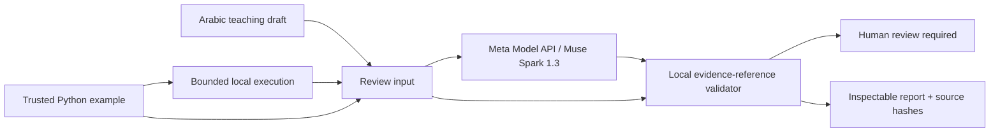

# Architecture

The demonstration runner executes only a fixed checked-in fixture with a timeout and output bound. It does not run arbitrary code or shell commands suggested by the model. Supporting a general untrusted-code sandbox is outside this new review feature's scope.

The provider is a small direct Responses API client. Review acceptance and publication decisions do not come from the model: blocking findings produce a blocked human-review state, and a clean result still requires human review. The model can suggest changes; this prototype does not apply them automatically.

The local dashboard binds to loopback, serves a fixed page and two saved review records, and runs the same evidence validator against a tampered quotation. It does not expose credentials or proxy arbitrary filesystem paths.

The earlier `engine/` and Teaching IDE source represent the existing production system. Their individual setup and test surfaces are separate from this new review path.
